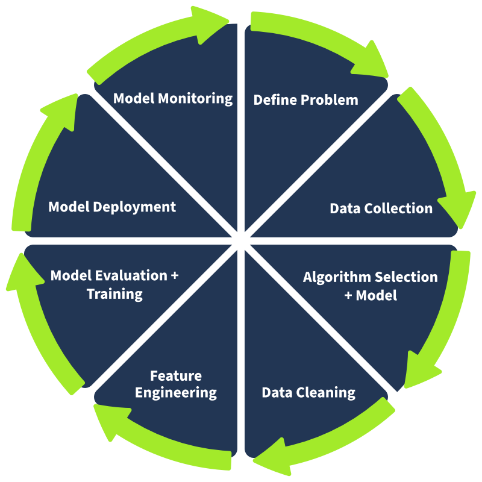
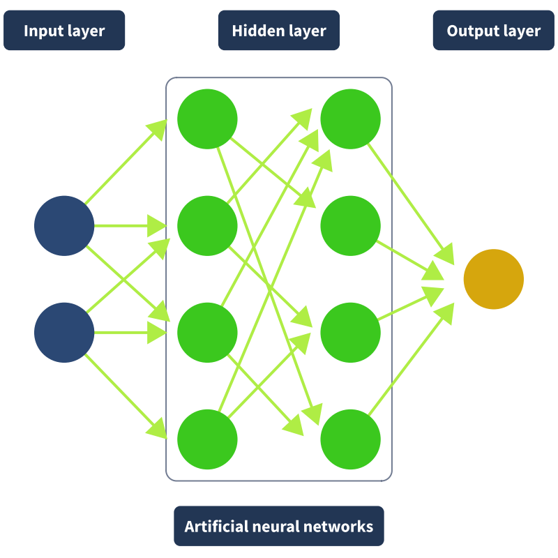

# AI Security

## The Building Blocks of AI

This is a write up from the TryHackMe ‘AI Security’ and ‘AI Fundamentals’ learning path that was also enhanced with external research.

### Main learning points

- What is Artificial Intelligence (AI) & Machine Learning (ML) and how they relate to each other?
- How ML algorithms work and how to categorize them?
- What are Deep Learning and Neural Networks, and why they matter?
- How can it be used in cyber-security?
- How are attackers leveraging it?

---

### Artificial Intelligence & Machine Learning

Although there is no set definition, an **Artificial Intelligence** refers to a machine or computer system that is able to carry out tasks that would otherwise require human reasoning, comprehension, problem-solving, or creativity.

**Machine Learning** is a subfield of AI that refers to a computer's ability to learn from data, usually through patterns, without being explicitly given instructions. With enough exposure to patterns, an ML algorithm gets better at recognizing and predicting them.

  

### Overfitting

**Overfitting** is a term used to define a situation whereby a model becomes so familiar with its training data that it fails to generalise to new, unseen data.

Example - studying for a math exam:

- **Good learning (generalisation):**
  - Understand the formulas and concepts.
  - When the exam contains new questions, the student can solve them thanks to their understanding of the underlying principles.
- **Overfitting:**
  - Memorizing the exact answers to practice questions.
  - When the exam contains slightly different questions, the student struggles because they've memorized instead of truly learned.

### ML Algorithms

ML algorithms are the mathematical methods used to learn patterns from data. The trained outputs are called ML models.

The basic structure of Machine Learning Algorithms:

**Decision process → Error Function → Model Optimization Process.**

The 4 categories of ML algorithms:

| Category | Definition | Context |
|---|---|---|
| Supervised Learning | Training data is labeled. Data comes with the correct answer. The model learns to map inputs to outputs based on them. | Classifying an email as legitimate, spam or phish |
| Unsupervised Learning | Data is unlabeled and the algorithm has to find its own structure. | Grouping customers by behavior or detecting anomalies in network traffic. |
| Semi-supervised Learning | A small portion of labeled data to guide the learning process across a much larger pool of unlabeled data. | Used when labeling data is either expensive or complex |
| Reinforcement Learning | Learns by taking actions in an environment and receiving rewards or penalties based on the outcomes. Behavior is then refined to maximize reward | Autonomous systems |

### Neural Networks

A neural network consists of 3 main layers of nodes:

- **Input layer:** receives raw data
- **Hidden layer:** Middle processing to refine the input and extract complex features depending on the amount of nodes. Each connection carries a weight that determines how much influence it has on the next layer.
- **Output layer:** Outputs the final prediction.

  

### Deep Learning

When a network has more than three layers, it qualifies as a **Deep Learning (DL)** algorithm.

DL doesn't require labeled data whereas ML needs a human to attach correct answers to training examples. No human intervention = larger datasets can be processed.

DL is often described as scalable ML.

### Large Language Models

**Large Language Models** are deep learning-based AI models that process and generate text by predicting the next word in a sequence.

LLMs are first trained in a pre-training phase, where they process enormous volumes of text.

LLMs rely on billions of parameters to encode the model’s understanding of language.

**Pretraining:** A model is fed a string with missing words and asked to find the missing word over and over. The answers are compared against the actual answer, parameters are adjusted and re-run until it is correct. The parameter adjustment is called ‘backpropagation’.

This scale of training was made possible through GPUs enabling parallel processing and transformer neural networks.

**Transformers** enabled parallel text processing instead of sequential word-by-word analysis through the concept of attention: the ability to assign different levels of importance to different words depending on context.

> Read: Google's 2017 paper [Attention is All You Need](https://arxiv.org/abs/1706.03762)

After pre-training, humans come back into the loop in a process called **RLHF** (Reinforcement Learning from Human Feedback).

---

*To be continued. Expected 19/10/2026 with “AI Security Threats”*
